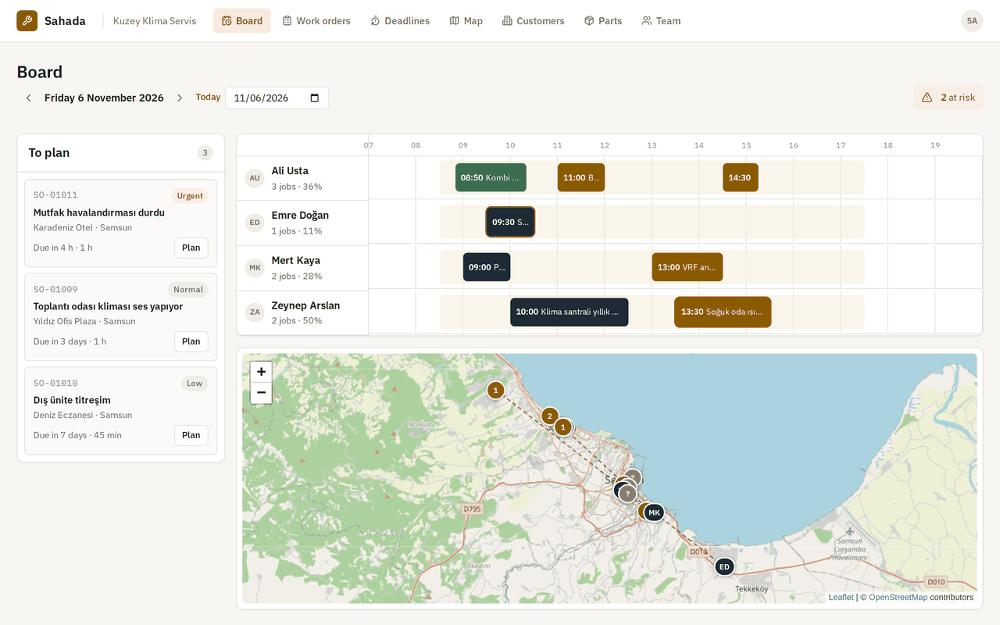
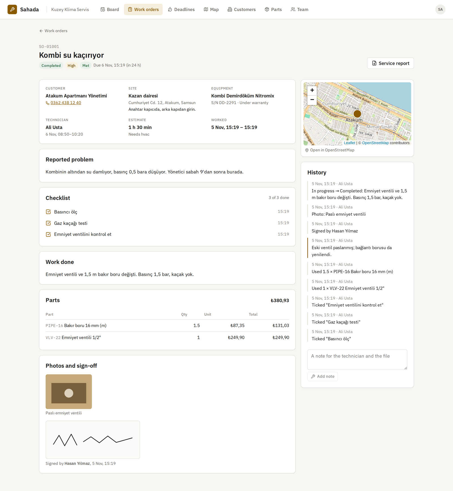
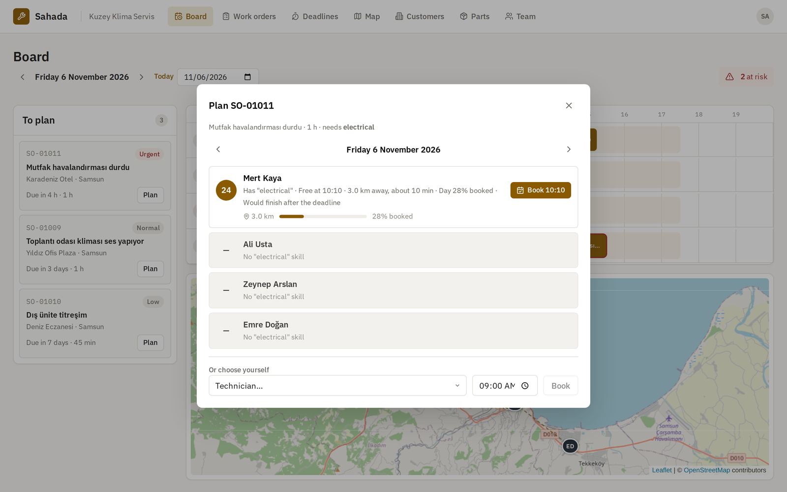
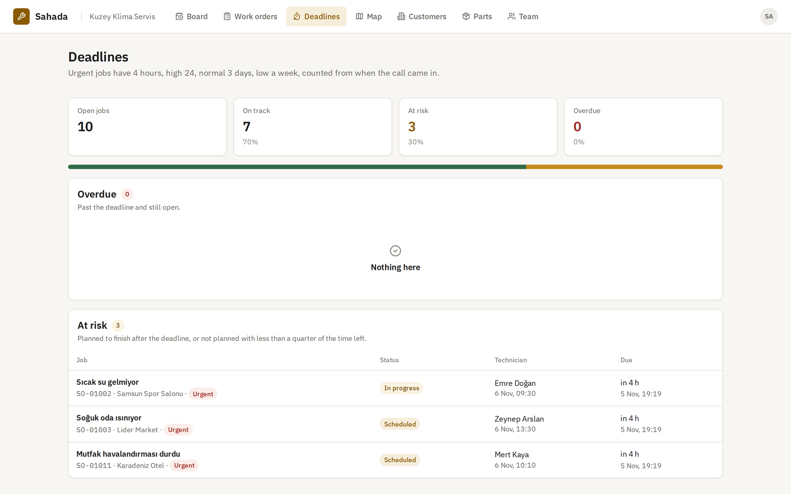
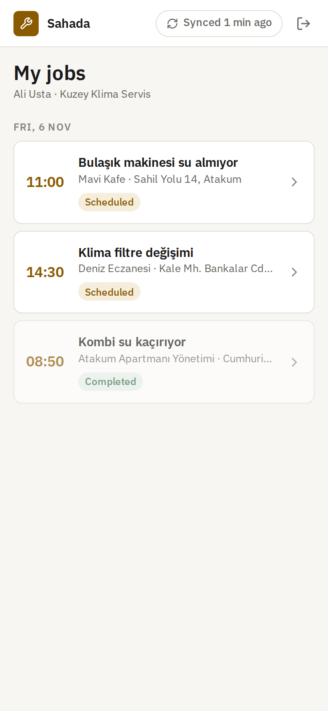
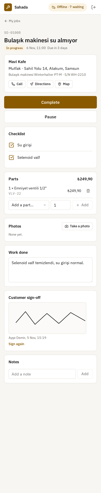
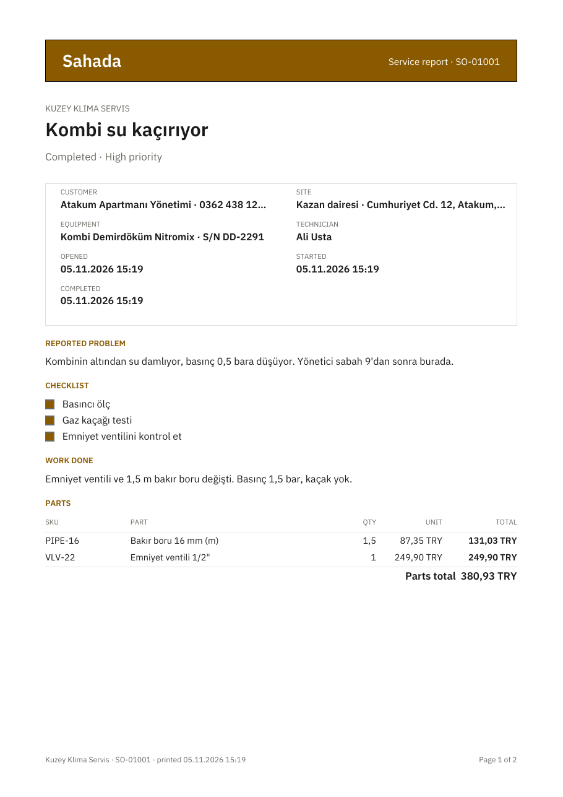
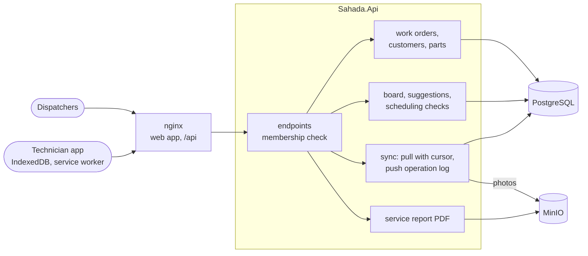

# Sahada

**English** · [Türkçe](README.tr.md)

Field service management for companies that send technicians out to fix things: boilers, air conditioners, cold rooms, electrical panels. The office takes in jobs, and each job's deadline follows its priority. On a day board the office plans who goes where, and the app suggests the technician with the right skill, a free slot and the shortest drive. Technicians work from a phone app that keeps working without a signal, in a basement or a plant room. Status changes, checklist ticks, parts, notes, photos and the customer's signature queue up on the phone and sync when the signal comes back. If the office changed the job in the meantime, clear rules decide what stands. Every finished job has a service report as a PDF.

[](https://github.com/Beratoguzhan620/sahada/actions/workflows/ci.yml)




## Try it

```bash
docker compose up --build
```

This starts PostgreSQL, MinIO for photos, the API and nginx with the web app. Open http://localhost:8080 and create an account, then create a company. Under *Team*, add a second account as a technician and give them skills and a shift. Add a customer with a site and open a work order for it. Plan it on the *Board*. Then sign in as the technician at http://localhost:8080/tech, ideally in a phone-sized window. Turn the connection off in the browser's developer tools and work through the job. Turn the connection back on and watch it sync.

- API reference: http://localhost:8080/scalar
- MinIO console: http://localhost:9001 (the user and password are in `docker-compose.yml`; change them in `.env`)

## Features

- **Companies and their teams:** technicians do the jobs, dispatchers also take in and plan them, and owners also manage the team. Membership and role are read from the database on every request. Technicians only ever see their own jobs, and anyone else's look like they do not exist.
- **Customers, sites and equipment:** sites have an address, a pin on the map and access notes ("key with the caretaker"). Equipment has a serial number and a warranty date, so the work order shows whether a job is under warranty.
- **Work orders:** numbered per company (SO-01001), with a priority that sets the deadline. Urgent jobs have 4 hours, high 24, normal 72 and low a week. A job can need a skill, comes with an estimate and a checklist, and keeps a full history. A job goes from new to scheduled, en route, in progress and completed, and can be put on hold or cancelled. It cannot be completed until every checklist item is ticked and the work is written up.
- **Planning:** technicians have skills, a base and a shift in the company's time zone. Booking checks the skill, the shift and clashes with other jobs. Two dispatchers booking the same slot at once cannot both get it.
- **Suggestions:** for a job and a day, every technician gets a score out of 100, with the reasons. The search looks for the earliest gap that fits the drive from the previous stop, the job itself and the drive on to the next stop.
- **Board, map and deadlines:** each technician's day on a timeline, the jobs still to plan, the day's routes on an OpenStreetMap map, and lists of jobs that are overdue or about to miss their deadline.
- **Technician app (PWA):** jobs, the parts catalog and queued work are kept in IndexedDB, and the app itself is cached by a service worker. It opens and works with no connection. Photos are shrunk on the phone before upload, and the customer signs on the screen. The app shows how many changes are waiting and what the server refused or flagged.
- **Sync:** the phone sends what it did as a log of operations, each with an id it chose. Pulls are incremental with a cursor. Retries are safe, and work done on a job that was cancelled or reassigned meanwhile is kept and flagged for the office.
- **Photos in object storage:** photos go to MinIO through the API's S3 client and come back only through the API. The bucket is never public. Uploads are checked by their first bytes, and a retry with the same bytes is a no-op.
- **Service report:** an A4 PDF with the job, the work done, the checklist, the parts and their total, photos and the signature, set in IBM Plex. The signature is drawn as lines, so it stays sharp at any size.

## Screenshots

| Day board with suggestions | Work order |
|---|---|
|  |  |
|  |  |

| Technician app | Offline | Service report |
|---|---|---|
|  |  |  |

More: [work orders](docs/screenshots/work-orders.png) · [map](docs/screenshots/map.png) · [customer](docs/screenshots/customer.png) · [sign-in](docs/screenshots/sign-in.png)

## Measured

`tests/load/load.mjs` runs a busy afternoon against the full Compose stack on a standard GitHub Actions runner (4 cores), with the load client on the same machine. There are 40 technicians with 5 booked jobs each. All of them come back online at once and send a day of offline work: 8 operations per job, 1,600 in all, in pushes of 10. Meanwhile the office cancels one job in four.

| Step | Result |
|---|---|
| Suggestions for one more job, with all 40 technicians and their 200 bookings | p50 7 ms, p95 10 ms |
| First pull on 40 phones (5 jobs each, with history, parts and the catalog) | p50 418 ms, p95 511 ms |
| 160 pushes of 10 operations, 40 phones at once | 460 operations a second; p50 790 ms, p95 1,016 ms per push |
| Outcomes | 1,280 applied; on the 40 cancelled jobs, 200 state changes refused and 120 records kept and flagged |
| Each phone sends its first push again | 400 of 400 answered as duplicates, nothing applied twice |
| The books afterwards | 200 jobs finished (160 completed, 40 cancelled), exactly 200 part lines, 120 flagged entries |
| Pull with a cursor after the storm | p50 366 ms; only the 5 changed jobs |
| Pull when nothing changed | p50 48 ms, 0 jobs |

What the numbers say:

- Retries and cancellations racing the phones left nothing doubled and nothing lost: every part fitted is a line, once, and every late note on a cancelled job is there, flagged.
- A push holds a lock on its job and applies operations one by one in their own transactions. That is the price of being exact, and 10 operations still take under a second with 40 phones syncing at the same moment.
- Numbers vary between runs on shared runners; an earlier run gave 886 operations a second.

## Tech stack

- ASP.NET Core 10: minimal APIs, ProblemDetails, OpenAPI with Scalar, JWT bearer, rate limiting
- PostgreSQL 17: row locks, advisory locks, `xmin` as a concurrency token, a trigger that stamps changes with `pg_current_xact_id()` for sync cursors; Entity Framework Core 10 and Npgsql
- MinIO through AWSSDK.S3; PdfPig for the service report with IBM Plex embedded
- React 18, TypeScript and Vite; IndexedDB and a service worker for the offline app; Leaflet with OpenStreetMap tiles; Lucide icons and IBM Plex; nginx
- xUnit, Testcontainers (PostgreSQL and MinIO), Vitest, Playwright
- GitHub Actions: warnings as errors, .NET and web tests, pending-migration check, browser walkthrough against the Compose stack
- Docker / Docker Compose

## Architecture



A job done offline, from the phone to the office:

```mermaid
sequenceDiagram
    participant T as Technician app
    participant A as API
    participant P as PostgreSQL
    participant S as MinIO
    participant D as Dispatcher
    T->>A: GET /sync/pull (no cursor)
    A-->>T: my jobs, the catalog, a cursor
    Note over T: signal lost: start, tick, parts, photo, signature, complete (queued in IndexedDB)
    D->>A: cancels another of the technician's jobs
    Note over T: signal back
    T->>A: PUT /photos/{id chosen on the phone}
    A->>S: store; row in PostgreSQL
    T->>A: POST /sync/push (operations in order, ids from the phone)
    A->>P: per operation: lock the job, check it was not seen, apply the rules, record the answer
    A-->>T: applied / flagged / stale / refused, with reasons
    T->>A: GET /sync/pull?cursor=…
    A-->>T: only the jobs changed since, and the ids to keep
    D->>A: GET /work-orders/{id}/report
```

## Design decisions

- **Two kinds of offline work.** Some operations change the job's state: status, checklist, resolution. Those only count while the job is still the technician's and still open, because the office may have moved on. Others record what happened on site: notes, parts, photos, the signature. Those are facts. They are always kept, and they are flagged for the office when they arrive for a job that was cancelled or reassigned. Nothing a technician did is silently lost, and nothing reopens a job the office closed.
- **Last write wins, by the clock that did it.** Checklist ticks compare the device's time with the last change on record, so a tick made at 10:05 offline does not undo an untick made at 10:20. Device times are clamped to the past week and never the future, so a wrong phone clock cannot put work before the job existed or in the future.
- **Exactly once without a queue.** Every operation carries an id from the phone. The server locks the job's row, checks whether it has seen the id, and records the answer in the same transaction as the work. A retry gets the first answer back. Two copies of one push racing each other end with one applied and one told it is a duplicate. Part lines and photos use ids from the phone too, so an upload that is retried lands once.
- **A cursor that never skips a change.** A trigger stamps every insert or update of a work order with the id of the transaction that made it. A pull returns rows stamped between the device's cursor and the oldest transaction still running, then hands back that point as the new cursor. A change that commits late is picked up next time instead of being skipped, which a plain timestamp or sequence cannot promise. Each pull also lists every job the device should hold, so a job given to someone else leaves the phone.
- **The phone shows its own work first.** The app keeps the server's copy of each job and lays the queued operations on top. The technician sees their changes at once. When the server answers, its copy replaces the local one, so anything it refused disappears and the reason is shown.
- **Suggestions that can be explained.** The score is simple on purpose: finishing before the deadline 40, starting soon 30, a short drive 20, a light day 10. Each part comes with a sentence. Distances are great-circle kilometres and drive times a rough city average, rounded to five minutes. A routing service could replace that behind the same function.
- **Bookings that cannot collide.** Scheduling takes an advisory lock per technician, then checks skill, shift and overlaps. Two dispatchers filling the same afternoon are checked one after the other. Concurrent edits to one work order are caught by PostgreSQL's `xmin` and answered with 409, not silently overwritten.
- **Photos in object storage, behind the API.** The browser never sees a bucket URL. The API checks access, streams the file and sends an ETag. The bytes are stored before the row is written, so a row never points at a missing file.
- **Signatures as strokes.** A signature is up to 4,000 points between 0 and 1. It is a few kilobytes, the same on any screen, and drawn as vector lines in the PDF.
- **Money in kuruş, times in UTC.** Prices are whole kuruş and part quantities have two decimals. Times are stored in UTC, and shifts and reports use the company's time zone (Europe/Istanbul).

## Commands

| Command | What it does |
|---|---|
| `docker compose up --build` | The whole app on http://localhost:8080, the MinIO console on http://localhost:9001 |
| `dotnet test` | .NET unit and integration tests (Docker needed for Testcontainers) |
| `cd web && npm install && npm test` | Web app unit tests |
| `cd web && npm run dev` | The web app with hot reload on http://localhost:5173, against the API on port 5700 |
| `cd tests/e2e && npm install && node sahada.mjs` | The browser walkthrough, against a stack started with `AUTH_ATTEMPTS_PER_MINUTE=1000` |
| `cd tests/e2e && node media.mjs` | A demo company and the README screenshots |
| `node tests/load/load.mjs 40 5` | The sync test, against a stack started with `AUTH_ATTEMPTS_PER_MINUTE=100000` |
| `dotnet ef migrations add <Name> --project src/Sahada.Infrastructure --startup-project src/Sahada.Api --output-dir Persistence/Migrations` | Add a migration |

Configuration for a local run, kept out of the repository:

```bash
dotnet user-secrets --project src/Sahada.Api set "ConnectionStrings:Sahada" "Host=localhost;Database=sahada;Username=…;Password=…"
dotnet user-secrets --project src/Sahada.Api set "Jwt:SigningKey" "<at least 32 characters>"
dotnet user-secrets --project src/Sahada.Api set "Storage:AccessKey" "<MinIO user>"
dotnet user-secrets --project src/Sahada.Api set "Storage:SecretKey" "<MinIO password>"
```

## Tests

181 tests and a run against the whole stack: 100 .NET unit tests, 61 integration tests that run the real API against PostgreSQL in Testcontainers (plus the S3 store against MinIO), 20 Vitest tests for the web app, and a 14-step Playwright walkthrough, all in CI.

- **Teams and data:** roles from technician to owner, outsiders unable to tell a company exists, the last owner kept, customers searched with wildcards treated as text, sites on the map, warranties, unique SKUs, and customers with history that cannot be deleted.
- **Work orders:** deadlines from priority and moved when it changes, numbers without gaps under twelve requests at once, every status change allowed and refused, completion blocked by open checklist items, technicians seeing only their own jobs, edits recorded, filters and overdue by the clock, and two saves at once not overwriting each other.
- **Planning:** shifts on the company's wall clock, skill, shift and clash checks, six dispatchers booking one slot at once with one winner, the first gap that fits the drive there and on, scores and reasons, the board, and deadlines at risk.
- **Sync:** first and incremental pulls, a day of offline work landing in order, the same operations sent twice and a retry racing the first try, work on a cancelled or reassigned job kept and flagged, strangers refused, last-write-wins ticks, future device times clamped, bad operations refused with nothing saved, photos uploaded once by id and refused when they are not images, and the report PDF read back.
- **Web app (Vitest):** offline work laid over the server's copy, pulls merged with jobs that left, completion rules, signature thinning, routes and formatting on the company's clock.
- **Browsers (CI):** an owner setting up a company, team, customer, site, equipment and parts; a job opened and planned from a suggestion; a technician signing in on a phone, losing the signal and doing the whole job offline with a part, a photo and a signature; the office cancelling another job meanwhile; syncing with the late work flagged; the dispatcher seeing it all and downloading the report; and no script errors or blocked resources.

## Roadmap and known gaps

- Real drive times from a routing service (OSRM, Valhalla) behind the planner; today it is a straight line and a city average.
- Recurring maintenance contracts that open work orders on a schedule.
- Notifications to the customer ("your technician is on the way") through the [notification-service](https://github.com/Beratoguzhan620/notification-service).
- Stock per van, so parts used on site come off a technician's own shelf.
- Photos are compressed on the phone but not resized again on the server; thumbnails would make long histories lighter.
- Site and customer edits do not wake devices up on their own; they arrive with the job's next change.

## License

[MIT](LICENSE) · Berat Oğuzhan Turğut · [GitHub](https://github.com/Beratoguzhan620)
