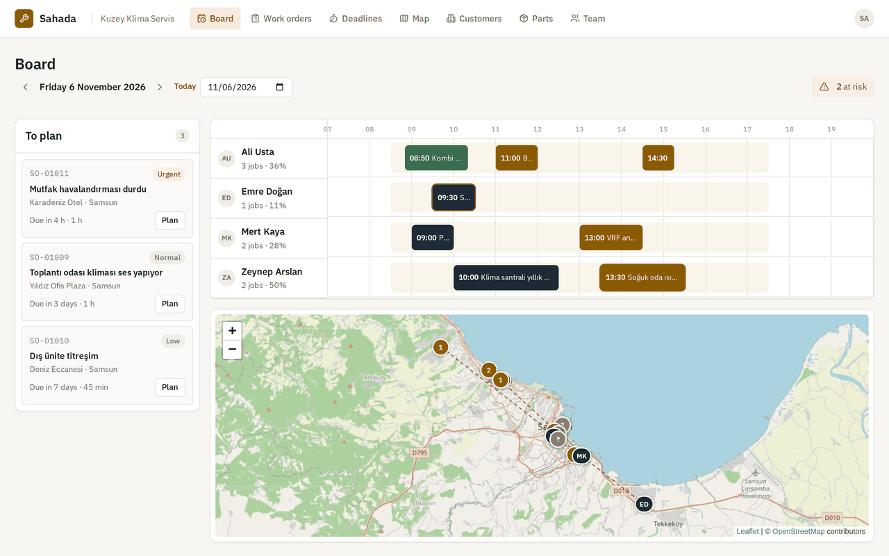
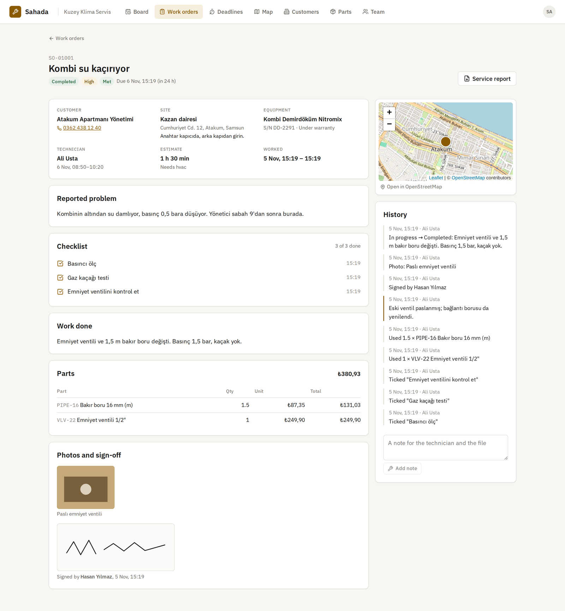
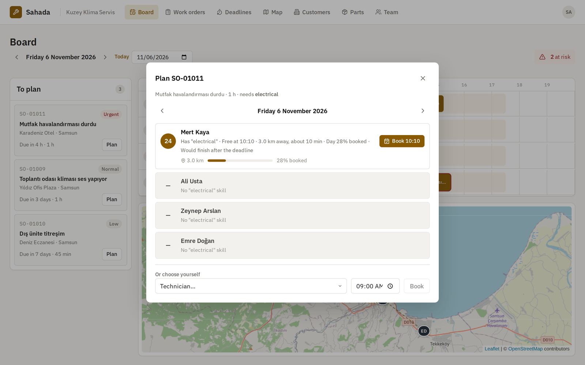
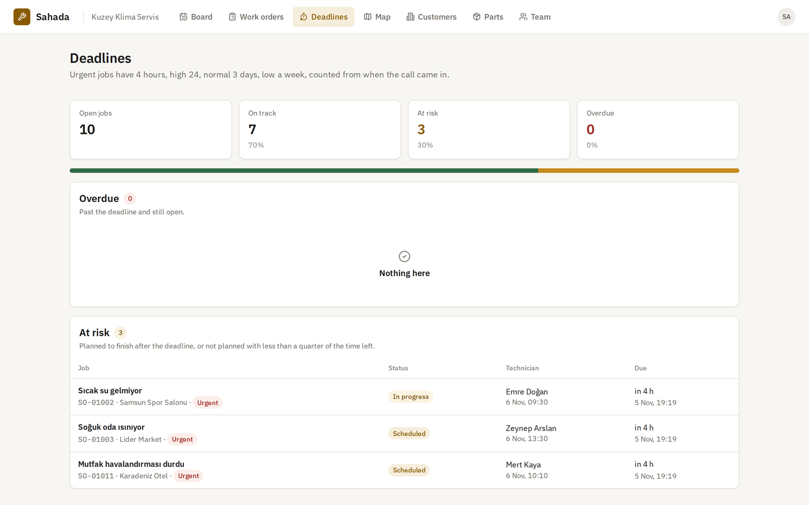
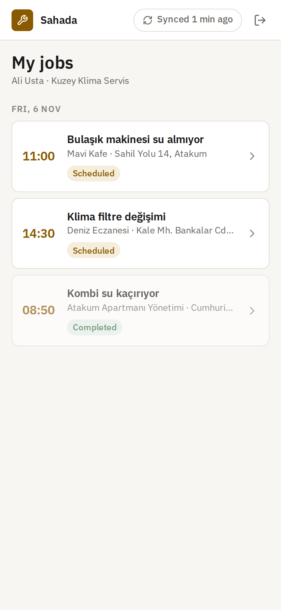
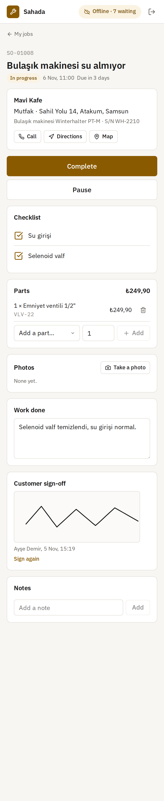
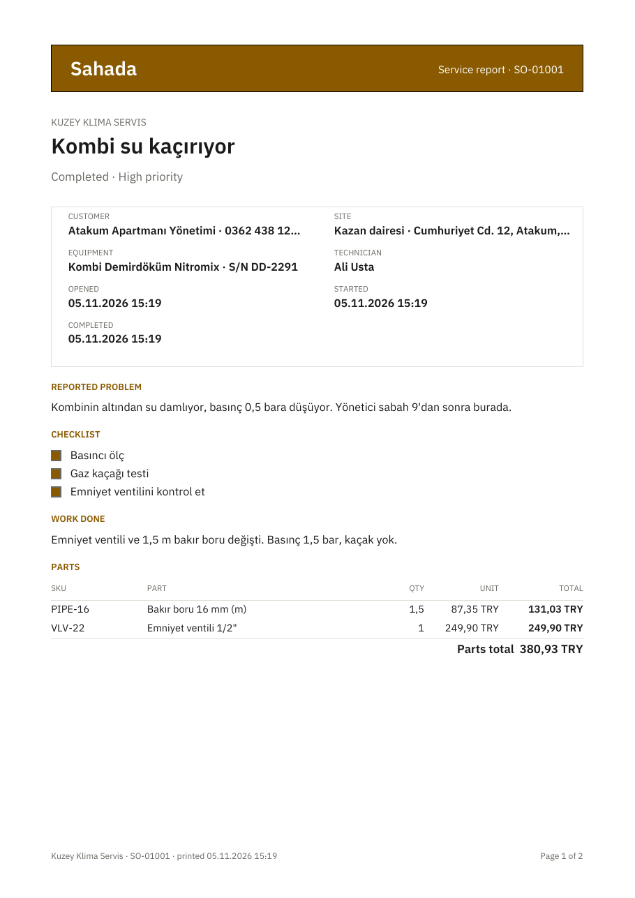
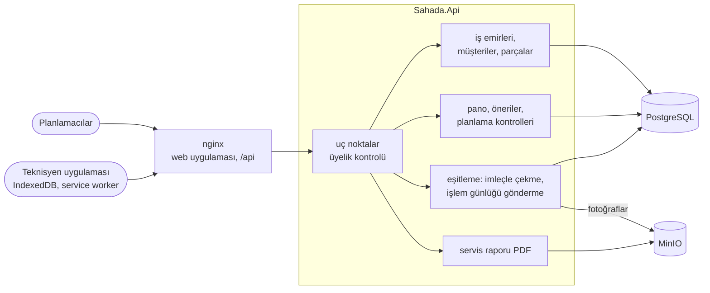

# Sahada

[English](README.md) · **Türkçe**

Teknisyenleri sahaya iş yapmaya gönderen şirketler için saha servis yönetimi: kombiler, klimalar, soğuk odalar, elektrik panoları. Ofis işleri kayda alır ve her işin son tarihi önceliğinden gelir. Ofis bir gün panosunda kimin nereye gideceğini planlar; uygulama doğru yeteneğe, boş bir zamana ve en kısa yola sahip teknisyeni önerir. Teknisyenler telefondaki uygulamayla çalışır; uygulama bodrumda ya da kazan dairesinde sinyal olmadan da çalışmaya devam eder. Durum değişiklikleri, kontrol listesi işaretleri, parçalar, notlar, fotoğraflar ve müşterinin imzası telefonda sıraya girer ve sinyal geri geldiğinde eşitlenir. Ofis bu arada işi değiştirdiyse neyin geçerli olacağına açık kurallar karar verir. Biten her işin PDF olarak bir servis raporu vardır.

[](https://github.com/Beratoguzhan620/sahada/actions/workflows/ci.yml)




## Deneyin

```bash
docker compose up --build
```

Bu komut PostgreSQL'i, fotoğraflar için MinIO'yu, API'yi ve web uygulamasıyla nginx'i başlatır. http://localhost:8080 adresini açıp bir hesap oluşturun, ardından bir şirket kurun. *Team* sayfasında ikinci bir hesabı teknisyen olarak ekleyip ona yetenekler ve bir vardiya verin. Bir müşteri ve adresini ekleyip onun için bir iş emri açın. İşi *Board* üzerinde planlayın. Sonra teknisyen olarak http://localhost:8080/tech adresinden, tercihen telefon boyutunda bir pencerede giriş yapın. Tarayıcının geliştirici araçlarından bağlantıyı kesin ve işi baştan sona yapın. Bağlantıyı geri açın ve eşitlenmesini izleyin.

- API dokümantasyonu: http://localhost:8080/scalar
- MinIO konsolu: http://localhost:9001 (kullanıcı ve parola `docker-compose.yml` içinde; `.env` ile değiştirin)

## Özellikler

- **Şirketler ve ekipleri:** teknisyenler işleri yapar, planlamacılar ayrıca işleri kayda alıp planlar, sahipler ayrıca ekibi yönetir. Üyelik ve rol her istekte veritabanından okunur. Teknisyenler yalnızca kendi işlerini görür; başkasının işi onlar için hiç yokmuş gibidir.
- **Müşteriler, adresler ve cihazlar:** adreslerin açık adresi, haritada bir iğnesi ve giriş notu ("anahtar kapıcıda") vardır. Cihazların seri numarası ve garanti tarihi vardır; böylece iş emri, işin garanti kapsamında olup olmadığını gösterir.
- **İş emirleri:** şirket başına numaralanır (SO-01001) ve önceliği son tarihi belirler. Acil işlerin 4 saati, yüksek önceliklilerin 24, normallerin 72 saati, düşüklerin bir haftası vardır. Bir iş bir yetenek gerektirebilir, bir süre tahmini ve kontrol listesiyle gelir ve tüm geçmişini tutar. İş yeni durumundan planlandı, yolda, devam ediyor ve tamamlandı durumlarına ilerler; beklemeye alınabilir ya da iptal edilebilir. Kontrol listesindeki her madde işaretlenip yapılan iş yazılmadan tamamlanamaz.
- **Planlama:** teknisyenlerin yetenekleri, bir çıkış noktası ve şirketin saat dilimine göre bir vardiyası vardır. Rezervasyon yeteneği, vardiyayı ve başka işlerle çakışmayı denetler. Aynı anda aynı zamanı ayıran iki planlamacıdan yalnızca biri alabilir.
- **Öneriler:** bir iş ve bir gün için her teknisyen, gerekçeleriyle birlikte 100 üzerinden bir puan alır. Arama, önceki duraktan gelme süresini, işin kendisini ve sonraki durağa gidiş süresini sığdıran en erken boşluğu bulur.
- **Pano, harita ve son tarihler:** her teknisyenin günü bir zaman çizelgesinde, planlanmayı bekleyen işler, günün rotaları bir OpenStreetMap haritasında ve süresi geçmiş ya da geçmek üzere olan işlerin listeleri.
- **Teknisyen uygulaması (PWA):** işler, parça kataloğu ve sıradaki işlemler IndexedDB'de tutulur; uygulamanın kendisi de bir service worker tarafından önbelleğe alınır. Bağlantı olmadan açılır ve çalışır. Fotoğraflar yüklenmeden önce telefonda küçültülür, müşteri ekranda imza atar. Uygulama kaç değişikliğin beklediğini ve sunucunun neyi reddettiğini ya da işaretlediğini gösterir.
- **Eşitleme:** telefon yaptıklarını, her biri kendi seçtiği bir kimlik taşıyan bir işlem günlüğü olarak gönderir. Çekmeler bir imleçle artımlıdır. Tekrar denemeler güvenlidir; bu arada iptal edilmiş ya da başkasına verilmiş bir işte yapılan iş saklanır ve ofis için işaretlenir.
- **Fotoğraflar nesne deposunda:** fotoğraflar API'nin S3 istemcisiyle MinIO'ya gider ve yalnızca API üzerinden geri gelir. Kova hiçbir zaman herkese açık değildir. Yüklemeler ilk baytlarına bakılarak denetlenir; aynı baytlarla yapılan tekrar deneme hiçbir şeyi değiştirmez.
- **Servis raporu:** iş, yapılan iş, kontrol listesi, parçalar ve toplamları, fotoğraflar ve imzayla A4 bir PDF; IBM Plex ile dizilir. İmza çizgi olarak çizilir, böylece her boyutta keskin kalır.

## Ekran görüntüleri

| Önerileriyle gün panosu | İş emri |
|---|---|
|  |  |
|  |  |

| Teknisyen uygulaması | Çevrimdışı | Servis raporu |
|---|---|---|
|  |  |  |

Daha fazlası: [iş emirleri](docs/screenshots/work-orders.png) · [harita](docs/screenshots/map.png) · [müşteri](docs/screenshots/customer.png) · [giriş](docs/screenshots/sign-in.png)

## Ölçümler

`tests/load/load.mjs` yoğun bir öğleden sonrayı, standart bir GitHub Actions makinesinde (4 çekirdek) tüm Compose ortamına karşı oynatır; yük istemcisi de aynı makinededir. Her birinin 5 planlı işi olan 40 teknisyen vardır. Hepsi aynı anda çevrimiçi olur ve bir günlük çevrimdışı işi gönderir: iş başına 8 işlem, toplam 1.600, 10'arlı gönderimlerle. Bu sırada ofis her dört işten birini iptal eder.

| Adım | Sonuç |
|---|---|
| 40 teknisyen ve 200 rezervasyonla bir iş daha için öneriler | p50 7 ms, p95 10 ms |
| 40 telefonda ilk çekme (her birinde geçmiş, parçalar ve katalogla 5 iş) | p50 418 ms, p95 511 ms |
| 10 işlemlik 160 gönderim, 40 telefon aynı anda | saniyede 460 işlem; gönderim başına p50 790 ms, p95 1.016 ms |
| Sonuçlar | 1.280 uygulandı; iptal edilen 40 işte 200 durum değişikliği reddedildi, 120 kayıt saklanıp işaretlendi |
| Her telefon ilk gönderimini yeniden yollar | 400'ün 400'ü tekrar olarak yanıtlandı, hiçbir şey iki kez uygulanmadı |
| Sonrasında hesap | 200 iş bitti (160 tamamlandı, 40 iptal), tam 200 parça satırı, 120 işaretli kayıt |
| Fırtınadan sonra imleçle çekme | p50 366 ms; yalnızca değişen 5 iş |
| Hiçbir şey değişmediğinde çekme | p50 48 ms, 0 iş |

Rakamların söyledikleri:

- Telefonlarla yarışan tekrar denemeler ve iptaller hiçbir şeyi ikilemedi ve kaybetmedi: takılan her parça bir satır, bir kez; iptal edilmiş işe geç gelen her not orada ve işaretli.
- Bir gönderim işinin satırını kilitler ve işlemleri tek tek, kendi işlemlerinde uygular. Kesinliğin bedeli budur; 40 telefon aynı anda eşitlenirken bile 10 işlem bir saniyenin altında sürer.
- Ortak makinelerde rakamlar çalıştırmadan çalıştırmaya değişir; daha önceki bir çalıştırma saniyede 886 işlem verdi.

## Teknolojiler

- ASP.NET Core 10: minimal API'ler, ProblemDetails, Scalar ile OpenAPI, JWT bearer, istek sınırlama
- PostgreSQL 17: satır kilitleri, advisory lock'lar, eşzamanlılık belirteci olarak `xmin`, eşitleme imleçleri için değişiklikleri `pg_current_xact_id()` ile damgalayan bir tetikleyici; Entity Framework Core 10 ve Npgsql
- AWSSDK.S3 üzerinden MinIO; servis raporu için IBM Plex gömülü PdfPig
- React 18, TypeScript ve Vite; çevrimdışı uygulama için IndexedDB ve service worker; OpenStreetMap haritalarıyla Leaflet; Lucide ikonları ve IBM Plex; nginx
- xUnit, Testcontainers (PostgreSQL ve MinIO), Vitest, Playwright
- GitHub Actions: uyarılar hata sayılır, .NET ve web testleri, eksik migration kontrolü, Compose ortamına karşı tarayıcı senaryosu
- Docker / Docker Compose

## Mimari



Çevrimdışı yapılan bir iş, telefondan ofise:

```mermaid
sequenceDiagram
    participant T as Teknisyen uygulaması
    participant A as API
    participant P as PostgreSQL
    participant S as MinIO
    participant D as Planlamacı
    T->>A: GET /sync/pull (imleç yok)
    A-->>T: işlerim, katalog, bir imleç
    Note over T: sinyal gitti: başla, işaretle, parça, fotoğraf, imza, tamamla (IndexedDB'de sırada)
    D->>A: teknisyenin başka bir işini iptal eder
    Note over T: sinyal geldi
    T->>A: PUT /photos/{telefonun seçtiği kimlik}
    A->>S: sakla; PostgreSQL'de satır
    T->>A: POST /sync/push (sırasıyla işlemler, kimlikler telefondan)
    A->>P: her işlem için: işi kilitle, görülmediğini denetle, kuralları uygula, yanıtı kaydet
    A-->>T: uygulandı / işaretlendi / eski / reddedildi, gerekçeleriyle
    T->>A: GET /sync/pull?cursor=…
    A-->>T: yalnızca o zamandan beri değişen işler ve tutulacak kimlikler
    D->>A: GET /work-orders/{id}/report
```

## Tasarım kararları

- **İki tür çevrimdışı iş.** Bazı işlemler işin durumunu değiştirir: durum, kontrol listesi, yapılan işin yazısı. Bunlar yalnızca iş hâlâ teknisyenin ve hâlâ açıkken sayılır, çünkü ofis bu arada başka karar vermiş olabilir. Diğerleri sahada olanı kaydeder: notlar, parçalar, fotoğraflar, imza. Bunlar olgudur. Her zaman saklanırlar; iptal edilmiş ya da başkasına verilmiş bir iş için gelirlerse ofis için işaretlenirler. Teknisyenin yaptığı hiçbir şey sessizce kaybolmaz ve ofisin kapattığı bir işi hiçbir şey yeniden açmaz.
- **Son yazan kazanır, onu yapan saate göre.** Kontrol listesi işaretleri cihazın saatini kayıttaki son değişiklikle karşılaştırır; çevrimdışıyken 10:05'te atılan bir işaret, 10:20'de kaldırılmış bir işareti geri getirmez. Cihaz saatleri son bir haftaya sıkıştırılır ve hiçbir zaman geleceğe gitmez; yanlış ayarlı bir telefon saati işi, iş oluşmadan önceye ya da geleceğe koyamaz.
- **Kuyruk olmadan tam bir kez.** Her işlem telefondan gelen bir kimlik taşır. Sunucu işin satırını kilitler, bu kimliği daha önce görüp görmediğine bakar ve yanıtı işle aynı işlemde kaydeder. Tekrar deneme ilk yanıtı geri alır. Aynı gönderimin yarışan iki kopyasından biri uygulanır, diğerine tekrar olduğu söylenir. Parça satırları ve fotoğraflar da telefondan gelen kimlikleri kullanır; tekrar denenen bir yükleme bir kez yer alır.
- **Hiçbir değişikliği atlamayan bir imleç.** Bir tetikleyici, bir iş emrinin her ekleme ya da güncellemesini onu yapan işlemin kimliğiyle damgalar. Bir çekme, cihazın imleciyle hâlâ süren en eski işlem arasında damgalanmış satırları döndürür ve bu noktayı yeni imleç olarak verir. Geç onaylanan bir değişiklik atlanmak yerine bir sonraki çekmede gelir; düz bir zaman damgası ya da sıra numarası bunu garanti edemez. Her çekme ayrıca cihazın tutması gereken tüm işleri listeler; başkasına verilen bir iş telefondan çıkar.
- **Telefon önce kendi yaptığını gösterir.** Uygulama her işin sunucudaki kopyasını tutar ve sıradaki işlemleri onun üzerine uygular. Teknisyen değişikliklerini hemen görür. Sunucu yanıt verince onun kopyası yerelin yerini alır; reddettiği şey kaybolur ve gerekçesi gösterilir.
- **Açıklanabilen öneriler.** Puan bilerek basittir: son tarihten önce bitirmek 40, erken başlamak 30, kısa yol 20, hafif bir gün 10. Her parçanın bir cümlesi vardır. Mesafeler kuş uçuşu kilometre, yol süreleri kaba bir şehir ortalamasıdır ve beş dakikaya yuvarlanır. Aynı fonksiyonun arkasına bir rota servisi konabilir.
- **Çakışamayan rezervasyonlar.** Planlama teknisyen başına bir advisory lock alır, sonra yeteneği, vardiyayı ve çakışmaları denetler. Aynı öğleden sonrayı dolduran iki planlamacı sırayla denetlenir. Bir iş emrine aynı anda yapılan düzenlemeleri PostgreSQL'in `xmin` değeri yakalar ve sessizce üzerine yazmak yerine 409 döner.
- **Fotoğraflar nesne deposunda, API'nin arkasında.** Tarayıcı hiçbir zaman bir kova adresi görmez. API erişimi denetler, dosyayı akıtır ve bir ETag gönderir. Baytlar satırdan önce saklanır; böylece bir satır hiçbir zaman olmayan bir dosyayı göstermez.
- **Çizgi olarak imzalar.** Bir imza 0 ile 1 arasında en fazla 4.000 noktadır. Birkaç kilobayttır, her ekranda aynıdır ve PDF'te vektör çizgiler olarak çizilir.
- **Para kuruş, zaman UTC.** Fiyatlar tam kuruştur, parça miktarları iki ondalıklıdır. Zamanlar UTC olarak saklanır; vardiyalar ve raporlar şirketin saat dilimini (Europe/Istanbul) kullanır.

## Komutlar

| Komut | Ne yapar |
|---|---|
| `docker compose up --build` | Tüm uygulama http://localhost:8080 adresinde, MinIO konsolu http://localhost:9001 adresinde |
| `dotnet test` | .NET birim ve entegrasyon testleri (Testcontainers için Docker gerekir) |
| `cd web && npm install && npm test` | Web uygulaması birim testleri |
| `cd web && npm run dev` | Web uygulaması http://localhost:5173 adresinde canlı yenilemeyle, 5700 portundaki API'ye karşı |
| `cd tests/e2e && npm install && node sahada.mjs` | Tarayıcı senaryosu, `AUTH_ATTEMPTS_PER_MINUTE=1000` ile başlatılmış ortama karşı |
| `cd tests/e2e && node media.mjs` | Örnek bir şirket ve README ekran görüntüleri |
| `node tests/load/load.mjs 40 5` | Eşitleme testi, `AUTH_ATTEMPTS_PER_MINUTE=100000` ile başlatılmış ortama karşı |
| `dotnet ef migrations add <Ad> --project src/Sahada.Infrastructure --startup-project src/Sahada.Api --output-dir Persistence/Migrations` | Migration ekler |

Yerel çalıştırma için depoya girmeyen ayarlar:

```bash
dotnet user-secrets --project src/Sahada.Api set "ConnectionStrings:Sahada" "Host=localhost;Database=sahada;Username=…;Password=…"
dotnet user-secrets --project src/Sahada.Api set "Jwt:SigningKey" "<en az 32 karakter>"
dotnet user-secrets --project src/Sahada.Api set "Storage:AccessKey" "<MinIO kullanıcısı>"
dotnet user-secrets --project src/Sahada.Api set "Storage:SecretKey" "<MinIO parolası>"
```

## Testler

181 test ve tüm ortama karşı bir çalıştırma: 100 .NET birim testi, gerçek API'yi Testcontainers içindeki PostgreSQL'e karşı çalıştıran 61 entegrasyon testi (S3 deposunun MinIO'ya karşı testi dahil), web uygulaması için 20 Vitest testi ve 14 adımlık bir Playwright senaryosu; hepsi CI'da.

- **Ekipler ve veriler:** teknisyenden sahibe roller, dışarıdakilerin bir şirketin varlığını anlayamaması, son sahibin korunması, joker karakterleri metin sayan müşteri araması, haritadaki adresler, garantiler, benzersiz stok kodları ve geçmişi olan müşterilerin silinememesi.
- **İş emirleri:** öncelikten gelen ve öncelik değişince kayan son tarihler, aynı anda gelen on iki istekte boşluksuz numaralar, izin verilen ve reddedilen her durum geçişi, açık kontrol listesi maddelerinin tamamlamayı engellemesi, teknisyenlerin yalnızca kendi işlerini görmesi, kayda geçen düzenlemeler, filtreler ve saate göre gecikme, aynı anda iki kaydın birbirinin üzerine yazmaması.
- **Planlama:** şirketin saatine göre vardiyalar, yetenek, vardiya ve çakışma kontrolleri, aynı zamanı aynı anda ayıran altı planlamacıdan tek kazanan, gidiş ve sonraki yolu sığdıran ilk boşluk, puanlar ve gerekçeler, pano ve riskteki son tarihler.
- **Eşitleme:** ilk ve artımlı çekmeler, sırasıyla gelen bir günlük çevrimdışı iş, iki kez gönderilen aynı işlemler ve ilk denemeyle yarışan tekrar, iptal edilmiş ya da başkasına verilmiş işte yapılanın saklanıp işaretlenmesi, yabancıların reddi, son yazanın kazandığı işaretler, sıkıştırılan gelecek tarihli cihaz saatleri, hiçbir şey kaydetmeden reddedilen hatalı işlemler, kimliğiyle bir kez yüklenen ve görüntü değilse reddedilen fotoğraflar, geri okunan rapor PDF'i.
- **Web uygulaması (Vitest):** sunucu kopyasının üzerine uygulanan çevrimdışı iş, ayrılan işlerle birleştirilen çekmeler, tamamlama kuralları, imza seyreltme, adresler ve şirket saatine göre biçimlendirme.
- **Tarayıcılar (CI):** şirketi, ekibi, müşteriyi, adresi, cihazı ve parçaları kuran bir sahip; açılıp bir öneriden planlanan bir iş; telefonda giriş yapan, sinyali giden ve tüm işi bir parça, bir fotoğraf ve bir imzayla çevrimdışı yapan bir teknisyen; bu arada başka bir işi iptal eden ofis; geç işin işaretlendiği eşitleme; hepsini görüp raporu indiren planlamacı; ve hiçbir betik hatası ya da engellenen kaynak olmaması.

## Yol haritası ve bilinen eksikler

- Planlayıcının arkasında bir rota servisinden (OSRM, Valhalla) gerçek yol süreleri; bugün düz bir çizgi ve şehir ortalaması.
- Belirli aralıklarla iş emri açan periyodik bakım sözleşmeleri.
- Müşteriye bildirimler ("teknisyeniniz yolda") [notification-service](https://github.com/Beratoguzhan620/notification-service) üzerinden.
- Araç başına stok; sahada kullanılan parçalar teknisyenin kendi rafından düşsün.
- Fotoğraflar telefonda sıkıştırılır ama sunucuda yeniden boyutlandırılmaz; küçük önizlemeler uzun geçmişleri hafifletir.
- Adres ve müşteri düzenlemeleri cihazları kendiliğinden uyandırmaz; işin bir sonraki değişikliğiyle gelir.

## Lisans

[MIT](LICENSE) · Berat Oğuzhan Turğut · [GitHub](https://github.com/Beratoguzhan620)
